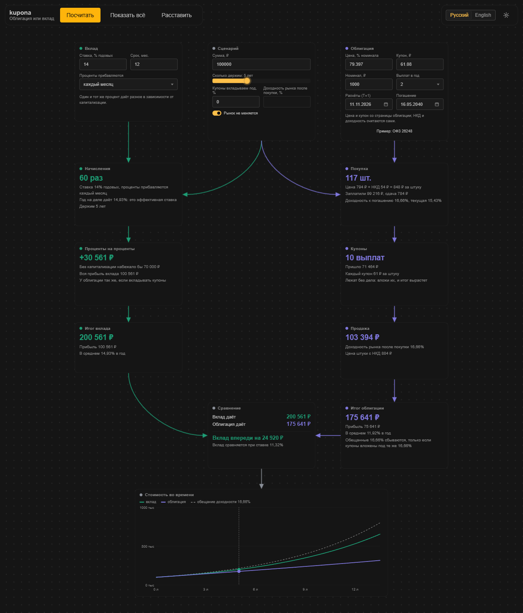
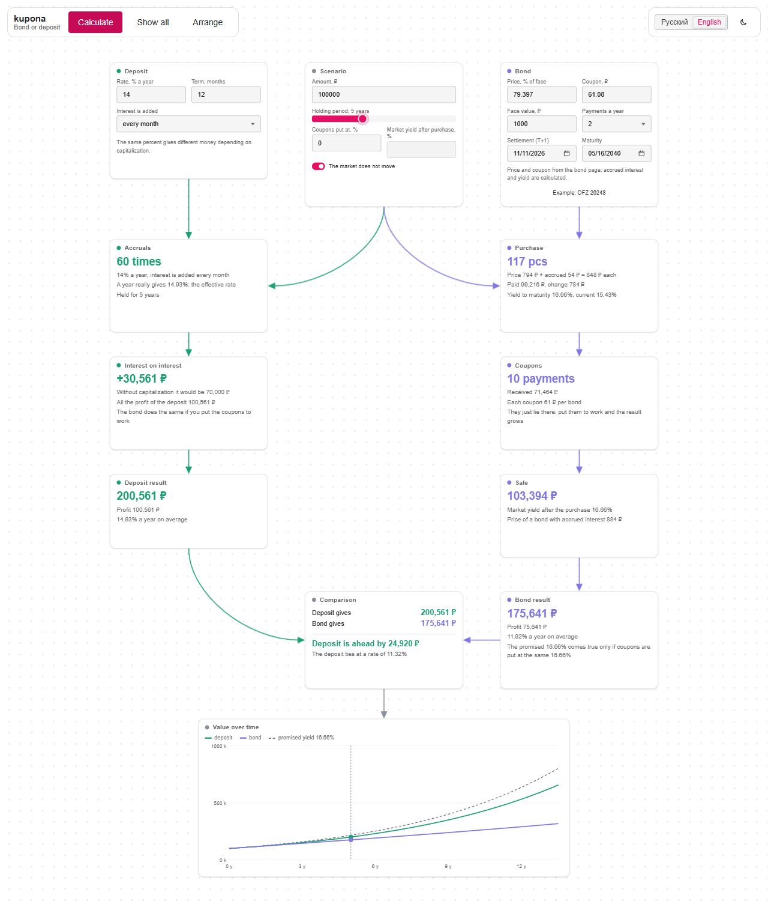

# kupona

<p align="center">
  
  
</p>

**English** · [Русский](README.ru.md)

Bond or deposit? Put them side by side and see what you end up with, step by step. A yield on a bond is one number, what lands in your account at the end is another, and it depends on what you do with the coupons and where the market goes. A few base figures go into a node, you press "Calculate", and a chain of nodes grows from it, each showing one stage: purchase, coupons, interest on interest, sale or maturity, the result. The deposit is on the left, the bond on the right, the comparison and a chart at the bottom.

**Stack:** Vue 3 + TypeScript + Vite, UI on [TaoUI](https://www.npmjs.com/package/@1337exp/taoui), canvas and links from [TaoUX](https://www.npmjs.com/package/@1337exp/taoux). Tests: Vitest.

```bash
npm install
npm run dev         # dev server
npm run build       # type check and build
npm test            # tests
npm run typecheck
npm run screenshot  # docs/media/*.png for the README, needs Chrome or Edge
```

## What it does

Three nodes you type into: **Deposit** (rate, how interest is added, term), **Scenario** (the amount, how long you hold, where coupons go, where the market goes after the purchase) and **Bond** (price, coupon, payments a year, nominal, the two dates). The page opens with the OFZ 26248 example.

"Calculate" grows the chain level by level, the camera following it. After that everything is live: change a field or drag the holding-period slider and every node recounts.

| Node | What it says |
|---|---|
| Accruals | how many times interest was added, the effective rate of the deposit |
| Interest on interest | how much of the profit is plain interest and how much is interest on interest |
| Purchase | pieces bought, clean price + accrued interest, yield to maturity, current yield |
| Coupons | payments received, and whether they lie idle or earn something |
| Sale / Maturity | what the bond brings at the horizon, at the market yield you set |
| Results, Comparison | final sums, who is ahead and by how much, the deposit rate that ties |
| Value over time | the deposit, the bond (price + coupons + what they earned) and the line the yield "promises" |

Nodes can be dragged, the canvas panned and zoomed. Russian and English, light and dark theme; inputs are remembered in the browser.

## The calculation core

`src/core`, no DOM. Rates are fractions (`0.1225` is 12.25%), time is in years from the purchase (act/365).

- **Bond** (`bond.ts`): coupon schedule counted back from maturity in fixed periods (OFZ: 182 days), accrued interest, yield to maturity, current yield, durations, the value of the payments still ahead at any yield (the price when you sell early), and the value of the payments already received if each is reinvested at a given rate.
- **Deposit** (`deposit.ts`): nominal rate, capitalization (end of term, daily, monthly, quarterly, yearly), term; the balance is renewed term after term.
- **Comparison** (`compare.ts`): the same money and horizon on both sides, one scenario, the difference, and the deposit rate at which it ties with the bond.

Checked against a real quote: OFZ 26248 on smart-lab.ru (`src/core/presets.ts`): accrued interest 54.03 ₽, yield 16.66%, current yield 15.43%, duration within two days. The page's "years to maturity" (13.56) is two weeks behind its own price: counted from the settlement date it is 13.52.

The point of the whole thing, in numbers from that example: the 16.66% only comes true if every coupon is reinvested at 16.66%. With coupons lying idle the same bond gives about 9% a year; with coupons put at 14% about 15.2%.

Assumptions: whole bonds only (the change lies idle), a deposit's tail shorter than a term earns the same rate, the market yield moves once, right after the purchase.

## How it is built

```
src/
  core/    bond, deposit, comparison, dates, bisection, presets: no Vue, no DOM
  app/     what is typed (percent, empty fields) and how it reaches the core, the text of every
           step as data, chart lines, the shape of the chain, the store: no DOM except the store
  ui/      node views and the node bodies
  i18n/    ru and en
scripts/   screenshots for the README
tests/     core: exchange page numbers, hand-computed cases, invariants; tests/app: the app layer
```

The chain is built for you, so the canvas has no pins to drag. The panels sit beside the canvas, not inside it: the canvas captures the pointer and would swallow the clicks.

Tests were checked by breaking the code on purpose (57 mutants, all caught): `node E:\job\base\snippets\mutate.mjs`.

## Not yet

Taxes and broker commission. Deposits in another currency (needs a rate of exchange). A curve of future rates instead of one market yield. Bonds with floating or amortizing coupons. Loading a bond by ticker. Saving node positions, undo, a file to save and open. Touch use is not checked on a real device.

## License

[MIT](LICENSE)

## Us

Homepage: [666.io](https://666.io). If you want to help, suggest an idea or just talk, come by.
