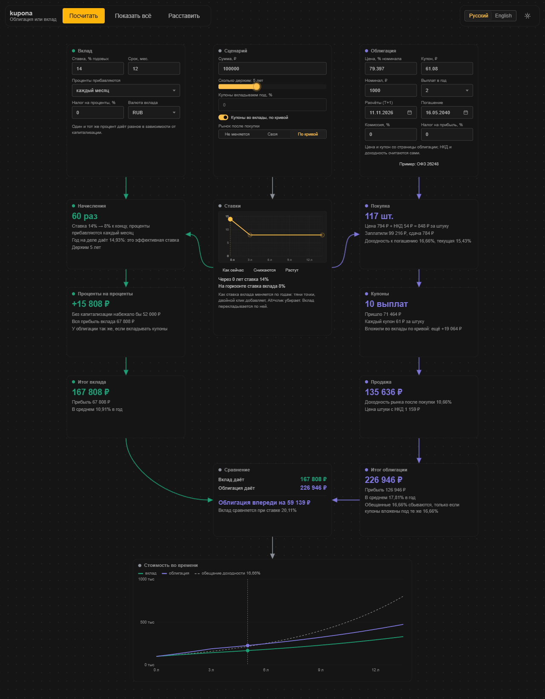
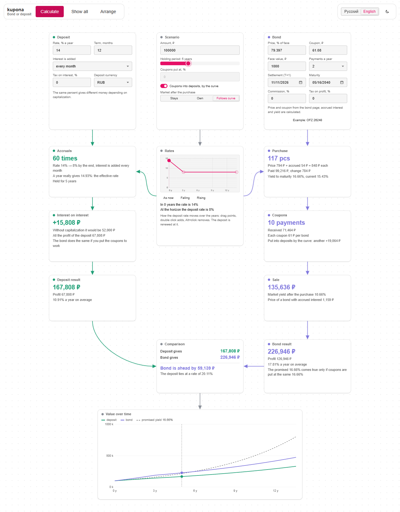

# kupona

<p align="center">
  
  
</p>

[English](README.md) · **Русский**

Облигация или вклад? Кладём их рядом и смотрим, что получится в конце, по шагам. Доходность облигации это одно число, а то, что упадёт на счёт в конце, другое: оно зависит от того, что делать с купонами и куда пойдёт рынок. Несколько базовых цифр вносим в ноду, жмём «Посчитать», и от неё вырастает цепочка нод, каждая показывает свой этап: покупка, купоны, проценты на проценты, продажа или погашение, итог. Вклад слева, облигация справа, внизу сравнение и график.

**Стек:** Vue 3 + TypeScript + Vite, интерфейс на [TaoUI](https://www.npmjs.com/package/@1337exp/taoui), холст и связи из [TaoUX](https://www.npmjs.com/package/@1337exp/taoux). Тесты: Vitest.

```bash
npm install
npm run dev         # dev-сервер
npm run build       # проверка типов и сборка
npm test            # тесты
npm run typecheck
npm run screenshot  # docs/media/*.png для README, нужен Chrome или Edge
```

## Что умеет

Три ноды, в которые вносят цифры: **Вклад** (ставка, как прибавляются проценты, срок, налог на проценты, валюта), **Сценарий** (сумма, сколько держим, куда идут купоны, куда пойдёт рынок после покупки) и **Облигация** (цена, купон, выплат в год, номинал, две даты, комиссия брокера, налог на прибыль). Комиссия и налоги равны 0, пока их не задашь; у каждой стороны своя ставка налога, потому что правила для вкладов и облигаций разные. Страница открывается с примером ОФЗ 26248.

**Валюта.** Вклад может быть в USD, EUR или CNY. Рубли меняют по курсу, который ты задаёшь (твоя цифра, не котировка), проценты идут в валюте, а в конце остаток меняют обратно по курсу того дня, который меняется на заданную долю в год. Ноды говорят, во что превратились рубли и что дал или отнял курс. Купоны во вклады и рынок по кривой есть только рядом с рублёвым вкладом: они привязывают облигацию к ставке рублёвого вклада.

**Ставки.** Четвёртая нода, кривая ставки вклада по годам, вырастает в середине после первого расчёта. Точки тянут мышью (двойной клик добавляет точку, Alt+клик убирает), или берут готовую форму: как сейчас, снижаются, растут. Вклад перекладывается по ставке того дня. В Сценарии купоны можно отправить во вклады (они зарабатывают ставку того дня), а рынок после покупки пустить по кривой: доходность облигации двигается на те же пункты, а с ней и цена продажи. Это ответ на вопрос «а если ставки упадут»: вклад не удержит свою ставку, а облигация зафиксировала купоны.

«Посчитать» выращивает цепочку по уровням, камера следует за ней. Дальше всё живое: поменяешь поле или подвинешь ползунок срока, и каждая нода пересчитается.

| Нода | Что говорит |
|---|---|
| Ставки | кривая ставки вклада; где она стоит на горизонте |
| Начисления | сколько раз прибавлялись проценты, эффективная ставка вклада, где кончается ставка, если она движется; для валюты, во что превратились рубли |
| Проценты на проценты | какая часть прибыли простые проценты, какая проценты на проценты |
| Покупка | сколько штук, чистая цена + НКД, доходность к погашению, текущая доходность, комиссия |
| Купоны | сколько выплат пришло и лежат ли они без дела или зарабатывают |
| Продажа / Погашение | что даёт облигация на горизонте при заданной доходности рынка (за вычетом комиссии продажи) |
| Итоги, Сравнение | конечные суммы, кто впереди и на сколько, ставка вклада, при которой он сравняется |
| Стоимость во времени | вклад, облигация (цена + купоны + их заработок) и линия, которую «обещает» доходность |

Ноды можно двигать, холст можно сдвигать и масштабировать. Русский и английский, светлая и тёмная тема; введённое запоминается в браузере.

## Ядро расчёта

`src/core`, без DOM. Ставки это доли (`0.1225` значит 12,25%), время в годах от покупки (act/365).

- **Облигация** (`bond.ts`): график купонов от погашения назад равными периодами (ОФЗ: 182 дня), НКД, доходность к погашению, текущая доходность, дюрации, стоимость оставшихся выплат при любой доходности (цена при продаже раньше срока) и стоимость уже полученных выплат, если каждую вложили под заданную ставку.
- **Вклад** (`deposit.ts`): номинальная ставка, капитализация (в конце срока, ежедневная, помесячная, поквартальная, годовая), срок; остаток продлевается срок за сроком, каждое продление по ставке того дня.
- **Валюта** (`currency.ts` и `exchange` вклада): вложенные рубли меняют по сегодняшнему курсу, вклад растёт в валюте, остаток меняют обратно по курсу дня (курс меняется на постоянную долю в год, со сложением). Прибыль делится на простые проценты, проценты на проценты, налог и то, что дал курс.
- **Ставки** (`rates.ts`): траектория сдвигов к сегодняшним ставкам; деньги, которые зарабатывают `база + сдвиг` каждое мгновение, не ниже нуля. Без траектории ничего не движется, и числа обычные.
- **Издержки** (`tax.ts` и параметры `compare.ts`): комиссия брокера при покупке и при продаже до погашения (при погашении без неё) и налог на прибыль: доля от заработанного сверх вложенного, платится в конце, с убытка ничего. График и «стоимость на момент» показаны после налога и комиссии закрытия в этот момент.
- **Сравнение** (`compare.ts`): те же деньги и тот же горизонт с обеих сторон, один сценарий, разница и ставка вклада, при которой он сравняется с облигацией.

Сверено с живой котировкой: ОФЗ 26248 на smart-lab.ru (`src/core/presets.ts`): НКД 54,03 ₽, доходность 16,66%, текущая доходность 15,43%, дюрация с расхождением в два дня. «Лет до погашения» на той странице (13,56) отстаёт от её же цены на две недели: от даты расчётов выходит 13,52.

Главное, ради чего всё это, в цифрах этого примера: 16,66% сбываются, только если каждый купон вложить под 16,66%. Если купоны лежат, та же облигация даёт около 9% годовых; если вкладывать их под 14%, около 15,2%.

Допущения: налог на валютный вклад берётся с процентов в валюте, перемена курса не облагается; в жизни курсы покупки и продажи у банка разные, здесь один; налог это одна доля от всей прибыли в конце (без сроков уплаты, необлагаемых сумм и зачётов), комиссия это доля от суммы каждой сделки, только целые облигации (сдача лежит без дела), «хвост» вклада короче срока считается по той же ставке, вклад держит ставку весь срок, а «хвост» короче срока зарабатывает ставку последнего продления; вся цена дисконтируется по одной доходности дня (плоская кривая, как котировка на экране); доходность облигации двигается параллельно ставке вклада (спред остаётся).

## Как устроено

```
src/
  core/    облигация, вклад, сравнение, даты, бисекция, примеры: без Vue и DOM
  app/     что вводят (проценты, пустые поля) и как это доходит до ядра, текст каждого шага
           данными, линии графика, форма цепочки, стор: без DOM, кроме стора
  ui/      вид нод и их содержимое
  i18n/    ru и en
scripts/   скриншоты для README
tests/     ядро: цифры со страницы биржи, ручные случаи, инварианты; tests/app: слой приложения
```

Цепочку строят за тебя, поэтому у холста нет пинов, которые тянут руками. Панели стоят рядом с холстом, а не внутри: холст захватывает указатель и проглотил бы клики.

Тесты проверены намеренной порчей кода (172 мутанта, все пойманы): `node E:\job\base\snippets\mutate.mjs`.

## Пока нет

Курс валюты кривой, облигации в валюте, спред банка. Облигации с плавающим и амортизируемым купоном. Загрузка облигации по тикеру. Сохранение положения нод, отмена, файл для сохранения и открытия. Сенсорное управление не проверено на настоящем устройстве.

## Лицензия

[MIT](LICENSE)

## Мы

Домашняя страница: [666.io](https://666.io). Хочешь помочь, предложить идею или просто поговорить — заходи.
